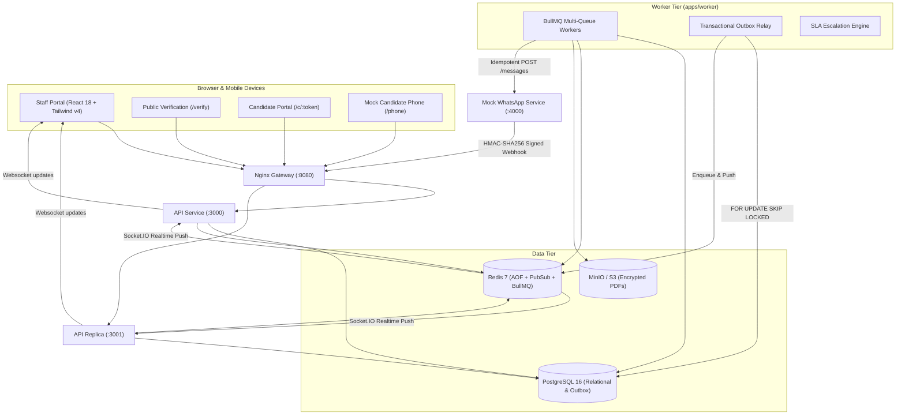

# CertiFlow 🎓

> **Pragati Skills Mission (PSM)** — Enterprise Skilling Certificate Issuance Platform  
> An auditable, resilient, multi-tier certificate issuance and delivery pipeline. Centres submit candidate batches; district, quality, and state officers review with cryptographic traceability; certificates are delivered directly to candidates' phones over WhatsApp with exactly-once delivery guarantees; anyone can verify certificates publicly in seconds.

---

## 📑 Table of Contents
- [Executive Overview](#-executive-overview)
- [System Architecture](#-system-architecture)
- [The 6 Core Moments & "Never" Invariants](#-the-6-core-moments--never-invariants)
- [Demo Personas & Roles](#-demo-personas--roles)
- [Quick Start](#-quick-start)
  - [Docker Compose (Recommended)](#docker-compose-recommended)
  - [Fast 2-Minute Demo SLA](#fast-2-minute-demo-sla)
  - [Local Development (Without Docker)](#local-development-without-docker)
- [Service Matrix & URLs](#-service-matrix--urls)
- [Web Application Flow & Screens](#-web-application-flow--screens)
- [WhatsApp Delivery Engine & Mock Service](#-whatsapp-delivery-engine--mock-service)
- [Security & Cryptographic Guarantees](#-security--cryptographic-guarantees)
- [Test Suite & Automated Verification](#-test-suite--automated-verification)
- [Architectural Decision Log](#-architectural-decision-log)

---

## 🏛 Executive Overview

CertiFlow replaces paper and error-prone email workflows with a high-integrity, automated skilling certificate lifecycle:
1. **Spreadsheet Ingestion**: Centres upload candidate spreadsheets (`.xlsx` or `.csv`). CertiFlow validates all rows before saving, pinpointing exact cell coordinates, values, and errors, and blocking CSV formula injection attacks.
2. **Multi-Tier Audited Approvals**: Two distinct District Officers must approve every batch. Large batches ($\ge 50$ candidates) automatically route through a Quality Officer. The State Office grants final approval. Every decision is recorded in an append-only audit trail protected by database triggers.
3. **Optimistic Concurrency**: Zero race conditions. Multiple reviewers working simultaneously are protected by versioned concurrency (`If-Match` / `ETag`). Stale submissions are rejected with a clear explanation of who acted first.
4. **Resilient WhatsApp Delivery**: Upon final approval, background workers generate tamper-evident PDFs, upload them to S3/MinIO, and dispatch them to candidates over WhatsApp. Idempotent keys (`dlv-<id>-g<n>`) prevent duplicate messaging across network timeouts, 5xx server errors, and 429 rate limits.
5. **Public Instant Verification**: Anyone can verify certificates via certificate number or QR code without logging in. The system supports live client-side PDF verification using Web Cryptography (SHA-256) so files never leave the verifier's browser, along with bilingual support in English and Hindi.
6. **Audited Revocation & SLA Tracking**: Real-time SLA monitoring escalates stuck batches. Revocations take effect immediately and irreversibly across Postgres and Redis write-through caches.

---

## 🏗 System Architecture



### Technology Stack
- **Monorepo**: npm workspaces (`apps/api`, `apps/worker`, `apps/mock-whatsapp`, `apps/web`, `packages/server`, `packages/shared`)
- **Runtime**: Node.js $\ge 22$, TypeScript 5.7, `tsx` for high-performance direct execution
- **Database & ORM**: PostgreSQL 16 with Prisma ORM 6.5, custom append-only triggers, and partial indexes
- **Queues & Storage**: BullMQ 5.41 with Redis 7 (AOF persistence), MinIO / S3 object storage
- **Realtime**: Socket.IO with Redis Adapter and Redis Emitter
- **Frontend**: React 18, Vite 7, Tailwind CSS v4, TanStack Query v5, Radix UI primitives, Lucide icons, ZXing browser QR reader
- **Gateway**: Nginx Alpine with connection pooling and dynamic upstream DNS resolution

---

## ⚡ The 6 Core Moments & "Never" Invariants

| Moment | Requirement | Implementation Details |
|---|---|---|
| **M1: Spreadsheet Import** | Ingest candidate spreadsheets; validate all rows before saving | Validates full file; echoes offending row, column, and cell value. Enforces E.164 phone normalization, date sanity (14–100 yrs), score bounds (0–100), and rejects spreadsheet formula injection (`=`, `+`, `-`, `@`). |
| **M2: Concurrent Review** | Two distinct District Officers must approve; no duplicate approvals | Optimistic concurrency via `version` header (`If-Match`). Database-level partial unique index prevents one officer approving twice. Stale reviews return `409 Conflict` with the name of the officer who acted first. |
| **M3: WhatsApp Delivery** | 60+ candidates issued reliably over unstable WhatsApp | Transactional Outbox Pattern + BullMQ. Idempotency keys (`dlv-<id>-g<gen>`) guarantee exactly-once delivery across provider 500s, 429 rate limits, and network timeouts. Dead-letter queue captures persistent failures for audited re-drive. |
| **M4: Instant Revocation** | Revoke certificate; public verify immediately reflects status | Irreversible state transition. Writes through to Redis cache (`REVOKED`) and database. Revoked download links return `410 Gone`. Verifier displays clear red status while concealing private revocation reasons. |
| **M5: SLA Breach Detection** | 48-hour SLA per review step; flag stuck batches | BullMQ delayed check scheduled upon step entry, supplemented by periodic sweep. SLA timers update live on screen. Breached batches highlight in red across queues and state dashboards. |
| **M6: Send-Back & Resubmit** | Reviewer sends batch back for fixes; centre resubmits | All prior approvals are marked `superseded` (never deleted). Revision counter increments. Batch resets to `PENDING_DISTRICT` requiring 2 fresh approvals. Complete historical audit log preserved. |

### The Five "Never" Invariants
1. **Never Wrong Actor**: Role-based access control (`can(user, action, batch)`) enforced at both route middleware and service layer. Centre managers can never approve; district officers cannot touch other districts; state officers cannot bypass quality checks.
2. **Never Duplicate Certificates**: Certificate numbers format `PSM-YYYY-<10 Crockford Base32><Luhn Mod-32 Checksum>`. Enforced by database unique constraint with deterministic generation.
3. **Never Revoked Shown Genuine**: Write-through cache invalidation. A cached `REVOKED` state cannot be overwritten by a stale reader.
4. **Never Data Leak**: Public verification endpoint whitelists only: masked name (`A**** S****`), course, centre, district, issue date, and validity status. Never reveals phone numbers, enrolment IDs, scores, or revocation reasons.
5. **Never Untraceable Decision**: Append-only `AuditLog` and `Approval` tables protected by PostgreSQL triggers blocking `UPDATE` and `DELETE`.

---

## 👥 Demo Personas & Roles

CertiFlow includes pre-seeded demo accounts across two districts (**Nagpur** and **Amravati**). Switch personas instantly via the top-right account dropdown:

| Persona | Role | District / Centre | Responsibilities |
|---|---|---|---|
| **Anika Sharma** | `CENTRE` | Nagpur (Mahesh IT Centre) | Creates batches, uploads spreadsheets, corrects sent-back batches |
| **Dev Joshi** | `DISTRICT_OFFICER` | Nagpur District | First district reviewer; approves or sends back batches |
| **Meera Nair** | `DISTRICT_OFFICER` | Nagpur District | Second district reviewer; satisfies two-officer approval rule |
| **Kabir Khan** | `QUALITY` | Nagpur District | Reviews large batches ($\ge 50$ candidates) flagged for quality |
| **Neha Rao** | `STATE` | State Office | Monitors state overview, investigates stuck batches |
| **Farah Siddiqui**| `STATE` | State Office (Director) | Final batch approval, issues certificates, re-drives DLQ, revokes |
| **Ravi Verma** | `CENTRE` | Amravati (Vidarbha Skills) | Isolated secondary centre to prove district boundary enforcement |
| **Isha Patel** | `DISTRICT_OFFICER` | Amravati District | Isolated officer; cannot view or act on Nagpur batches |

---

## 🚀 Quick Start

### Docker Compose (Recommended)
Starts all services, applies database migrations, seeds reference demo data, and configures the environment:

```bash
docker compose up --build
```

Scale services horizontally with:
```bash
docker compose up --build --scale api=2 --scale worker=3
```

### Fast 2-Minute Demo SLA
To demo automatic SLA breach detection and escalation without waiting 48 hours:
```bash
SLA_OVERRIDE_SECONDS=120 docker compose up --build
```

### Local Development (Without Docker)
1. **Dependencies**: Node.js $\ge 22$, PostgreSQL 16, Redis 7, MinIO.
2. **Environment**: Copy the environment configuration:
   ```bash
   cp .env.example .env
   ```
3. **Install & Initialize**:
   ```bash
   npm install
   npx prisma generate
   npx prisma migrate deploy
   npm run db:seed
   ```
4. **Start Development Services** (in separate terminals or via scripts):
   ```bash
   npm run dev:mock     # Mock WhatsApp Provider on :4000
   npm run dev:api      # REST API & Socket.IO on :3000
   npm run dev:worker   # BullMQ Background Worker & Outbox Relay
   npm run dev:web      # Vite Dev Server on :5173 (proxies to :3000 and :4000)
   ```

---

## 🌐 Service Matrix & URLs

| Service / View | URL | Credentials / Notes |
|---|---|---|
| **Web Portal** | `http://localhost:8080` | Role switcher available in top-right or login screen |
| **Public Certificate Verification** | `http://localhost:8080/verify` | Public; test with QR scanner or certificate number |
| **Mock Candidate Smartphone** | `http://localhost:8080/phone` | Simulates candidate handset inbox & delivery ticks |
| **REST API & Health Check** | `http://localhost:3000/healthz` | Ready probe at `/readyz`, Prometheus metrics at `/metrics` |
| **BullMQ Dashboard (Bull Board)** | `http://localhost:8080/admin/queues` | Sign in as **Farah** (`STATE`) first to access |
| **MinIO Storage Console** | `http://localhost:9001` | Username: `certiflow` · Password: `certiflow-secret` |

---

## 🖥 Web Application Flow & Screens

### 1. Login & Persona Switcher (`/login`)
- Quick one-click sign-in for all 6 demo personas.
- Explanatory feature callouts and live status display.

### 2. Centre Dashboard & Batch Creation (`/dashboard`, `/batches/new`)
- High-level metric tiles: batches by status, certificates issued, candidates in review.
- Multi-step batch creation wizard:
  1. Course metadata (Qualification pack code, start and end dates).
  2. Spreadsheet drag-and-drop (`.xlsx` or `.csv`).
  3. Real-time validation table showing exact cell coordinates and values for any error.
  4. Instant download of sample CSV template.

### 3. Review Queue & Concurrent Decisions (`/queue`, `/batches/:id`)
- Unified review queue prioritized by remaining SLA.
- Dual approval tracker showing required vs. received district signatures.
- Step pipeline progress indicator with conditional quality checkpoint.
- Decision Action Bar:
  - **Approve**: Instant approval (District 1) or confirmation modal (District 2 / Quality / Final State).
  - **Send Back**: Requires mandatory explanation to the centre; resets prior approvals.
  - **Reject**: Final rejection requiring acknowledgement checkbox.
  - **Withdraw Approval**: Allows an officer to withdraw an approval before the batch advances.
- Full audit timeline showing every actor, transition, timestamp, and metadata.

### 4. State Executive Views (`/overview`, `/stuck`, `/deliveries`, `/certificates`)
- **Overview**: System-wide statistics, daily issuance charts, bottleneck step latency.
- **Stuck Batches**: Live monitors for batches nearing or past SLA with owner tracking.
- **Deliveries**: Stacked progress bar per batch (`Delivered`, `Sent`, `Retrying`, `Queued`, `Failed`), and dead-letter queue with one-click re-drive.
- **Certificates**: Global certificate search, inline admin PDF download, and revocation modal with type-to-confirm safety prompt.

### 5. Public Verification & Candidate Portal (`/verify`, `/c/:token`)
- **Public Verification**: Search by number, live camera QR scanning, client-side SHA-256 PDF byte verification, rate-limit countdown.
- **Candidate Mobile View**: Opened directly from the candidate's WhatsApp link. Displays celebratory banner, verified course data, PDF download button, native share sheet, and dynamic QR code.
- **Internationalization**: One-click toggle between English and Hindi.

---

## 📱 WhatsApp Delivery Engine & Mock Service

CertiFlow models real-world enterprise delivery through a dedicated mock WhatsApp provider (`apps/mock-whatsapp`):

### 1. Delivery Architecture
```
Certificate Issued -> Outbox Event -> BullMQ Queue (whatsapp.send)
    -> HTTP POST /messages with Idempotency-Key
    -> Mock WhatsApp Provider (injected 500s, timeouts, 429 rate limits)
    -> Asynchronous HMAC-SHA256 Signed Webhook callback
    -> API verifies signature -> Updates Delivery status (DELIVERED / FAILED)
```

### 2. Idempotency & Fault Injection
- **Idempotency Header**: Every message has a deterministic key: `dlv-<deliveryId>-g<generation>`. Retrying after a timeout returns the existing message without duplicate sends.
- **Injected Unreliability**:
  - `MOCK_FAIL_500` (20%): Simulates transient internal server errors.
  - `MOCK_FAIL_TIMEOUT` (10%): Simulates dropped connections; half the time the provider accepted the message, testing idempotency on retry.
  - `MOCK_FAIL_429` (5%): Returns HTTP 429 with `Retry-After: 1` header. Worker respects the backoff.
  - `MOCK_WEBHOOK_FAIL` (2%): Handset unreachable; triggers generation increment (up to 3 generations) before moving to dead-letter queue.
- **Cross-Origin & Standalone Support**: Built-in CORS and path normalization ensure the interactive mock phone (`/phone`) works seamlessly both within Docker and in local development.

---

## 🔒 Security & Cryptographic Guarantees

1. **Tamper-Evident Certificate IDs**:
   $$\text{PSM} - \text{YYYY} - \text{CrockfordBase32}[10] - \text{LuhnMod32Checksum}$$
   Invalid characters or corrupted checksums are rejected before database or Redis queries occur.
2. **Download Token Integrity**:
   $$\text{Token} = \text{HMAC-SHA256}(\text{DOWNLOAD\_TOKEN\_SECRET}, \text{certificateId})$$
   The database stores only `SHA-256(Token)`. Even a full database dump leaks zero working download URLs.
3. **Client-Side Document Verification**:
   The verifier page computes `SHA-256` of an uploaded PDF locally in the browser using the Web Cryptography API (`crypto.subtle`). Only the 64-character hex digest is sent to the API, ensuring student documents remain private.
4. **Append-Only Immutability**:
   PostgreSQL triggers reject `UPDATE` and `DELETE` queries on the `AuditLog` table and `DELETE` queries on `Approval`.
5. **Secure Authentication**:
   JWT stored in `httpOnly`, `SameSite=Lax` cookies with strict cryptographic algorithm pinning (`HS256`).

---

## 🧪 Test Suite & Automated Verification

Run tests against real PostgreSQL, Redis, and MinIO instances:

```bash
# Run isolated unit tests (state machine, authorization matrix, schemas)
npm run test:unit

# Run full integration test suite via Docker
docker compose -f docker-compose.test.yml up --build --abort-on-container-exit --exit-code-from tests
```

### Test Coverage Matrix
| Requirement / Spec | Test File | Assertions Verified |
|---|---|---|
| **M1: Spreadsheet Validation** | `tests/m1-import.test.ts`, `tests/unit/candidateRow.test.ts` | Invalid phones, invalid dates, future dates, scores $>100$, duplicates, formula injection |
| **M2: Concurrent Review** | `tests/m2-concurrent-approvals.test.ts` | Version conflict 409 handling, dual approval requirement, isolation between districts |
| **M3: 60-Candidate Issuance** | `tests/m3-issuance.test.ts` | 60 unique certificates, 60 WhatsApp deliveries, survives 500s/timeouts/429s, worker restart recovery |
| **M4: Certificate Revocation** | `tests/m4-revocation.test.ts` | Instant verify cache update, download link returns 410, audit trail recorded |
| **M5: SLA Breach Detection** | `tests/m5-sla.test.ts` | Step timer transition, delayed job triggering, periodic sweep safety net |
| **M6: Resubmission Workflow** | `tests/m6-resubmit.test.ts` | Superseded approval tracking, revision incrementation, candidate roster replacement |
| **Never: Wrong Actor** | `tests/never-wrong-actor.test.ts`, `tests/unit/authorization.test.ts` | Role boundary violations, unauthorized transitions, invalid state jumps |
| **Never: Duplicates** | `tests/never-duplicates.test.ts` | Concurrent issuance idempotency, unique constraints, replay attack protection |
| **Never: Data Leak** | `tests/never-data-leak.test.ts` | Public verify response whitelisting, verification cache sanitization |
| **Never: Untraceable** | `tests/never-untraceable.test.ts` | Database trigger enforcement against audit log modification or deletion |

---

## 📜 Architectural Decision Log

Key architectural choices documented in [`docs/DECISIONS.md`](docs/DECISIONS.md):
- **D1 (Two Districts Seeded)**: Nagpur and Amravati seeded so district isolation can be verified.
- **D2 (Approval Partial Index)**: `UNIQUE (batchId, revision, step, officerId) WHERE superseded = false AND withdrawnAt IS NULL` prevents duplicate approvals while permitting re-approval after withdrawal.
- **D4 (Two-Officer District Rule)**: Two distinct district officers must approve; one officer can reject or send back immediately.
- **D7 (Candidate Replacement)**: Candidate re-upload replaces the roster completely; permitted only in `DRAFT` and `SENT_BACK` states.
- **D11 (HMAC Download Tokens)**: Tokens are computed on-the-fly with HMAC-SHA256, allowing background workers to reconstruct links without storing cleartext tokens.
- **D14 (Database Triggers for Audit Immutability)**: PostgreSQL triggers block `UPDATE` and `DELETE` on audit records.
- **D19 (Unified Origin Gateway)**: Nginx on `:8080` unifies frontend, API, WebSocket, and mock provider, eliminating browser cross-origin cookie quirks.
- **D22 (Optimistic Concurrency)**: All review state writes require `If-Match` version matching, preventing concurrent overwrites.
- **D24 (Delivery Idempotency & DLQ)**: At most one message per idempotency key, automatic retries with jittered backoff, and a dead-letter queue after 3 generations or 8 attempts.
- **D25 (Write-Through Revocation Cache)**: Revocations write directly to Redis and PostgreSQL, ensuring revoked certificates can never be served as valid.

---

*CertiFlow is designed for the fictional Pragati Skills Mission.*
