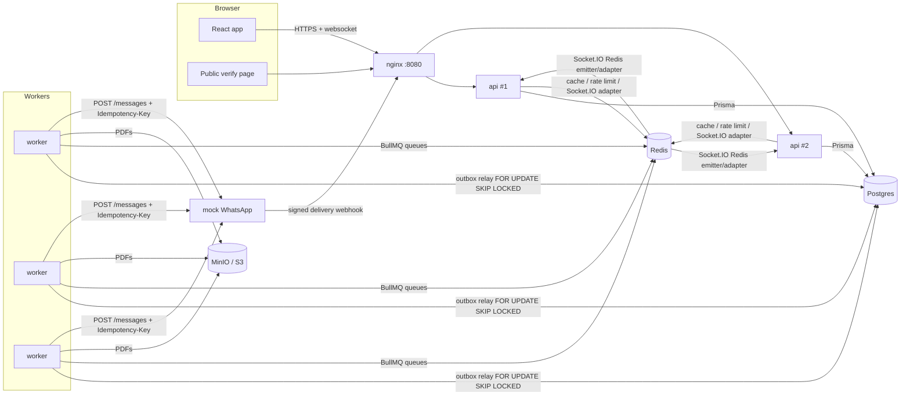

# Architecture

## Write path (every state change)

1. The API validates the request (zod), authenticates from the JWT cookie and authorises with `can(user, action, batch)`.
2. In ONE Postgres transaction, it runs:
   - the optimistic-locked `UPDATE Batch … WHERE version = ?`
   - the decision row
   - the `AuditLog` row
   - the `OutboxEvent` row
3. The outbox relay in the worker claims unpublished events (`FOR UPDATE SKIP LOCKED`), then:
   - adds each to the `outbox.events` BullMQ queue, with the event id as the job id
   - emits it to Socket.IO rooms through the Redis emitter
   - marks it published
4. Event handlers run the side effects idempotently: start issuance, enqueue WhatsApp sends, schedule SLA checks, re-assert the revoked cache.

## Queues

| Queue | Job id | Purpose |
|---|---|---|
| `outbox.events` | outbox event id | dispatch domain events to handlers |
| `certificate.generate` | `gen__<candidateId>` | PDF + certificate + delivery row |
| `whatsapp.send` | `send__<deliveryId>__g<n>` | provider call, jittered backoff, Retry-After |
| `whatsapp.dlq` | `dead__<deliveryId>__<key>` | dead letters, for inspection and re-drive |
| `sla.check` | `sla__<batchId>__<status>__<enteredAt>` + `sla-sweep` scheduler | escalation |

## Batch lifecycle

See `packages/shared/src/domain/batchStateMachine.ts` (single source of truth) and `docs/DECISIONS.md`.
